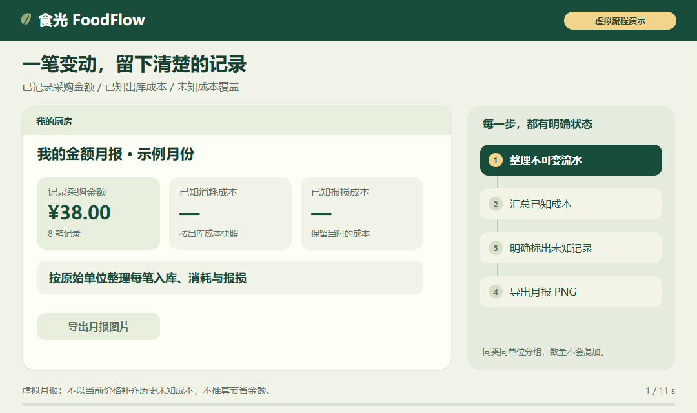
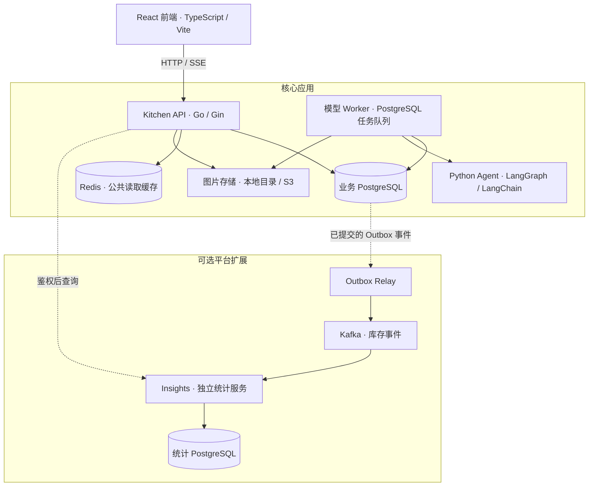

<p align="center">
  
</p>

<h1 align="center">FoodFlow 食光</h1>

<p align="center"><strong>从一人厨房开始，把食材、菜单和拿手菜连接起来。</strong></p>

<p align="center">
  <a href="#快速开始">快速开始</a> ·
  <a href="#从食材开始">功能介绍</a> ·
  <a href="#架构与技术栈">技术栈</a> ·
  <a href="#下载一次后续一键更新">一键更新</a> ·
  <a href="docs/README.md">项目文档</a>
</p>

<p align="center">
  <a href="https://github.com/link1ks/FoodFlow/actions/workflows/ci.yml"></a>
</p>

FoodFlow 是个人食材管理与 AI 膳食规划应用。登录后直接使用个人厨房，家庭共享按需开启；库存、菜单、采购和烹饪记录各有归属。AI 提出方案，用户确认后才执行库存变更。

从记下冰箱里的食材开始，安排想吃的一餐，再把采购、做饭和记录接起来。自己使用时有独立的个人厨房，需要协作时再创建家庭，也可以去社区分享拿手菜。

## 快速开始

运行需要 **Git、Docker 和 Docker Compose**。以下命令以 Windows PowerShell 为例；其他系统可以使用对应的文件复制命令。

```powershell
git clone https://github.com/link1ks/FoodFlow.git E:\FoodFlow
cd E:\FoodFlow
Copy-Item .env.example .env
```

打开 `.env`，将 `JWT_SECRET` 设置为至少 32 字节的随机密钥；数据库密码也可在首次启动前设置。随后启动（已包含必需的 Redis，无需额外启用平台扩展）：

```powershell
docker compose --project-directory . up --build -d --wait --wait-timeout 180
docker compose --project-directory . ps
```

| 入口 | 地址 |
| --- | --- |
| 应用 | <http://localhost:5173> |
| API | <http://localhost:8080/api> |
| 就绪检查 | <http://localhost:8080/health/ready> |

注册后即可进入个人厨房。菜单模型未配置时使用演示模式；真实菜单模型、图片识别、社区审核和短信需单独配置。模型 API 费用由服务商计费，完整设置见 [.env.example](.env.example) 与 [账号和 AI 额度](docs/ACCOUNT_RECOVERY_AI.md)。

需要独立、禁用收费集成的本机部署，可使用 [独立部署指南](docs/LEARNING_DEPLOYMENT.md)，地址为 `127.0.0.1:17173`，数据与默认部署分开保存。

<a id="可以做什么"></a>
<a id="功能实景"></a>

## 从食材开始

打开 **食材**，先看看冰箱里还有什么。每种食材都能查看图片、不同批次的余量和期限；新买的东西可以从目录选择，核对数量后入库。后续补货、报损和数量校准也留有记录。

下面按日常使用顺序介绍各项功能。每处「展开实际操作」只展示当前步骤，阅读时可以逐项打开。所有实录使用独立测试厨房和虚构数据；素材来源、预置数据及能力边界见 [录制说明](docs/SHOWCASE.md)。

<details>
<summary>展开实际操作：选生菜 → 核对 50 g → 确认入库</summary>

从食材主入口打开目录，搜索生菜并填写 50 g。确认前只是待提交内容，确认后库存卡片显示实际余量。


</details>

也可以通过照片或语音形成可编辑草稿，再由你核对。对应模型未配置时，目录录入仍可使用。语音采用独立配置的百炼 Qwen ASR，浏览器录音需要 HTTPS 或本机 localhost 和麦克风授权；配置和使用边界见 [语音入库](docs/VOICE_INTAKE.md)。

## 安排想吃的一餐

进入 **菜单**，浏览菜谱或搜索想用的食材，选择菜品、人数和餐次，再核对用量。确认菜单后，系统根据现有库存计算缺料；菜单草稿和确认菜单都不会提前扣库存。

例如，为 1 人安排蒜香生菜晚餐时，需要生菜 150 g。如果冰箱里已有 50 g，后续采购只需补齐不足的部分。

<details>
<summary>展开实际操作：搜索菜谱 → 安排晚餐 → 确认菜单</summary>

从菜谱中选择蒜香生菜，核对 1 人晚餐并确认。已安排的菜单和采购缺口随之出现，库存仍保持原值。


</details>

## 把采购和做饭接起来

### 缺什么，按清单补齐

在 **采购** 中查看这餐还缺的食材。上面的例子会得到生菜 100 g、蒜 10 g 的缺口。买回来后逐项核对实购数量、存放位置和日期，点击「确认并入库」才更新库存。

<details>
<summary>展开实际操作：核对缺口 → 确认实购 → 查看已入库</summary>

先确认生菜，再确认蒜；两项都完成后，库存达到生菜 150 g、蒜 10 g，采购清单显示已入库。


</details>

### 做完一餐，再记下消耗

回到 **今天**，查看已安排的菜单与临期提醒。实际做完后打开「烹饪完成」，核对并点击「确认完成并扣库」，这一餐才计入完成记录。

<details>
<summary>展开实际操作：查看今日菜单 → 确认完成 → 刷新核对</summary>

确认蒜香生菜已完成后，所用生菜和蒜被准确扣减。刷新页面后，菜单仍显示「已完成」。


</details>

采购确认负责把实际买入记进库存，烹饪确认负责把实际消耗记入流水。每一步都保留明确的确认入口，方便核对数量从哪里来、又用到了哪里。

## 回看厨房里的变化

进入 **记录**，可以查看库存流水、营养估算、食材用量和金额月报。数量变化能追溯到操作，月报也会区分已知金额和未知成本，支持下载 PNG。

历史记录没有填写的金额会继续保留未知，不用当前价格补齐，也不据此推算节省金额。阅读统计时，可以同时查看数据覆盖说明。

<details>
<summary>展开实际操作：查看流水 → 阅读金额覆盖 → 导出月报</summary>

从实际采购和烹饪流水切换到金额月报，核对已记录金额与未知成本，再点击导出；录制过程中实际下载的 PNG 也已核验。



</details>

## 和家人一起用

一个人使用时，登录后直接进入 **个人厨房**。需要共享时，从头像进入个人中心，创建或加入家庭，再切换到对应厨房。个人与家庭库存各自独立，访问权限由服务端校验。

<details>
<summary>展开实际操作：创建家庭 → 查看独立库存 → 切回个人厨房</summary>

新创建的家庭没有混入个人食材；切回个人厨房后，原有番茄 40 g 仍然保留。


</details>

## 分享一道拿手菜

在 **社区** 填写配方标题、食材用量和步骤，明确同意后提交初审。通过后可以查看、收藏和互动；审核未配置或异常时，动态保持私有。

<details>
<summary>展开实际操作：填写配方 → 同意初审 → 收藏并查看</summary>

这段实录使用本地确定性审核服务，展示真实提交与状态流转，不代表真实模型判断，也不包含管理员收录操作。


</details>

每周按点赞选出最多三道候选，每位作者最多一席，管理员确认后署名收录食谱库；积分用于徽章、头像框和主题。完整规则见 [社区指南](docs/COMMUNITY.md)。

## 下载一次，后续一键更新

首次通过 `git clone` 下载后，Windows 用户可以：

| 操作 | 方式 |
| --- | --- |
| 检查更新 | 双击 `check-update.cmd` |
| 更新源码 | 双击 `update.cmd` |
| 更新并重建默认 Docker 部署 | 先备份数据库与照片，再运行下面的命令 |

```powershell
powershell -NoProfile -ExecutionPolicy Bypass -File scripts/update.ps1 -Restart
```

脚本遇到本地修改、分支分叉或未完成的 Git 操作会停止，保留配置和数据。其他系统可使用 `git pull --ff-only`，再按原部署方式重建。

更新同步的是**代码**；不同电脑独立部署的账号、库存和照片不会自动同步。共享数据需访问同一个部署，迁移数据需配套备份数据库与照片。详细说明见 [一键更新](docs/UPDATING.md) 和 [备份恢复](docs/BACKUP_RECOVERY.md)。

## 架构与技术栈

前端采用 **React、TypeScript、Vite**，后端为 **Go API 与独立 Worker**，核心业务使用 **PostgreSQL**。**Redis 是必需依赖**，缓存公共食材目录、菜谱和官方价格查询；Kafka 与独立 Insights 服务用于可选的异步统计。

| 层次 | 技术 |
| --- | --- |
| 页面与状态 | React、TypeScript、Vite、Tailwind CSS、Radix、TanStack Query、Zustand |
| API 与后台任务 | Go、Gin、OpenAPI、SSE、PostgreSQL 任务队列 |
| 数据、缓存与迁移 | PostgreSQL、Redis、pgx、sqlc、goose |
| Agent 与模型 | Python 3.13、LangGraph 有界流程、LangChain 只读工具、兼容 Chat Completions 的模型适配器；Go Worker 管理权限及额度 |
| 图片与部署 | 本地目录 / S3、Docker Compose、GitHub Actions |
| 可选平台扩展 | Kafka / franz-go、独立 Insights 服务 |
| 测试与工程反馈 | Go testing、Testcontainers、Vitest、Playwright、工程 Harness |



库存、不可变流水与 Outbox 在同一事务提交；服务端校验厨房权限，幂等键防止重复写入。Redis 不保存权威库存或权限。设计细节见 [业务架构](docs/ARCHITECTURE.md) 与 [服务边界](docs/PLATFORM.md)。

所有部署均自动启动 Redis，且不向主机发布 Redis 端口。直接运行 API 时必须设置可访问的 `REDIS_URL`；未配置或连接失败会拒绝启动。Redis 故障会使就绪检查返回 503，运行中的公共读取仍可短时回源数据库；缓存最多保留 60 秒，公共菜谱入库和官方价格更新可能在此期间显示旧值。

### 开发与验证

开发与验收需要 Go 1.26、Python 3.13、Node.js 24、pnpm 11、PowerShell 7 和 Docker：

```powershell
powershell -NoProfile -ExecutionPolicy Bypass -File scripts/prepare-python-agent.ps1
pnpm --dir web install --frozen-lockfile
pnpm --dir web exec playwright install chromium
go run ./cmd/harness -mode full
go run ./cmd/harness -mode acceptance
```

`full` 检查源码约束、数据库集成、生成契约、前端测试与构建；`acceptance` 在独立环境验证浏览器、厨房流程和平台恢复。模型测试使用确定性 fixture。最新提交的云端结果见 [GitHub Actions](https://github.com/link1ks/FoodFlow/actions/workflows/ci.yml)，验证范围见 [验证说明](docs/VERIFICATION.md)。

Go 桥接将 Python Agent 源码嵌入二进制，通过独立子进程执行。本地优先使用
`.cache/python-agent-venv`，也可用 `FOODFLOW_PYTHON` 指定解释器；Docker 镜像已包含
Python 与 [锁定的 Agent 依赖](requirements-agent.txt)。

验证范围按 [仓库协作规则](AGENTS.md) 中的变更风险选择。最近 CI 已通过、且未影响长测试
覆盖行为的小改动，只跑相关短测试和静态检查；文档更新无需重复全量验收或部署。
需要完整交付验收时，再运行 `diagnose`、只读默认首页检查及当前提交的云端 CI，
并绑定需求、命名测试和反馈报告。具体命令与版本 2 完成包见 [工程 Harness](docs/HARNESS.md)。

| 目录 | 内容 |
| --- | --- |
| `cmd` / `internal` | 服务入口、业务、算法与模型适配器 |
| `web` | 应用页面、共享状态与公共资产 |
| `sql` / `api/openapi.yaml` | 数据库迁移、查询与 API 契约 |
| `scripts` / `tests` | 更新、部署、备份和验收工具 |
| `docs` | 项目设计、使用、维护和质量说明 |

更多入口：[文档导航](docs/README.md) · [开发与贡献](docs/CONTRIBUTING.md) · [安全说明](docs/SECURITY.md)。

## 当前范围

- 营养是原料组成估算，缺失数据保留未知；参考菜谱的份量与耗时为估计。
- 真实模型准确度、短信送达、S3、公网 HTTPS 与生产高可用仍需验收；应用额度控制不等于服务商账单封顶。
- 社区初审不替代人工入库审核；举报治理、多账号刷票防护与真实用户体验仍待完善。

完整未完成项见 [质量台账](docs/QUALITY.md)。当前前端与 API 版本为 **v0.3.0**，变更及验收边界见 [更新日志](docs/CHANGELOG.md)。

## 许可

项目尚未指定开源许可证，使用与分发授权由项目所有者明确。参考照片保留各自授权，见 [照片来源与署名](web/public/ingredient-photos/credits.html)。

食材配图使用 200 张 AI 生成的写实棚拍风参考图，统一浅奶油白背景、柔和光线、居中主体和 4:3 画布。家庭上传照片优先，缺图显示文字占位；参考图不代表实际库存或新鲜程度。图片说明与生成记录保留在 `web/public/ingredient-photos/` 和 `scripts/photos/studio-sources.json`。

目录约定：通用文档集中在 `docs/`，环境专用 Compose 文件在 `deploy/`，API 契约在 `api/openapi.yaml`，SQL 生成配置在 `sql/sqlc.yaml`（运行 `sqlc generate -f sql/sqlc.yaml`）。根目录保留 README、AGENTS 与默认 `compose.yaml` 入口。使用子目录 Compose 文件时必须从仓库根目录传入 `--project-directory .`，维护脚本已经统一处理，以保持构建路径、项目名和数据卷身份。
