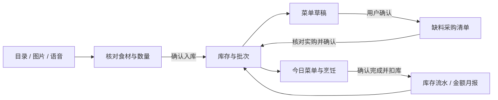
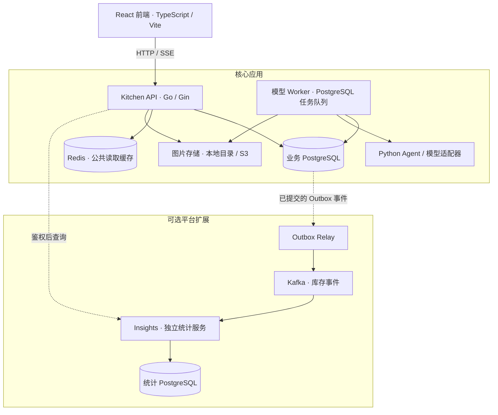

<p align="center">
  
</p>

<h1 align="center">FoodFlow 食光</h1>

<p align="center"><strong>从一人厨房开始，把食材、菜单和拿手菜连接起来。</strong></p>

<p align="center">
  <a href="#可以做什么">功能与实际操作</a> ·
  <a href="#架构与技术栈">技术栈</a> ·
  <a href="#快速开始">快速开始</a> ·
  <a href="#下载一次后续一键更新">一键更新</a> ·
  <a href="docs/README.md">项目文档</a>
</p>

<p align="center">
  <a href="https://github.com/link1ks/FoodFlow/actions/workflows/ci.yml"></a>
</p>

FoodFlow 是个人食材管理与 AI 膳食规划应用。登录后直接使用个人厨房，家庭共享按需开启；库存、菜单、采购和烹饪记录各有归属。AI 提出方案，用户确认后才执行库存变更。

<a id="功能实景"></a>

## 可以做什么

沿着应用里的导航查看各模块，操作画面放在对应功能下。演示使用独立测试厨房和虚构数据；配方社区初审使用本地确定性服务，真实模型效果另行验收。[录制范围与重建方法](docs/SHOWCASE.md)说明每一步的数据来源和边界。

### 今天 · 把安排好的一餐做完

集中查看今日菜单和临期提醒。打开「烹饪完成」，核对后点击「确认完成并扣库」；页面显示完成状态，刷新后仍保留结果。


### 食材 · 买了什么，核对后再入库

查看食材图片、多批次余量与期限。演示从食材目录选择生菜，填写 50 g，确认后库存卡片更新；图片与语音识别也遵循先草稿、再核对的流程，使用前需配置对应服务。


### 菜单 · 从想吃的菜安排一餐

浏览菜谱、搜索食材，选择喜欢的菜和餐次，再核对用量。演示安排 1 人份蒜香生菜，确认后生成采购缺口；菜单草稿与确认菜单均不会提前扣库存。


### 采购 · 按缺口买，按实购记

已有生菜 50 g，这餐需要 150 g，因此清单补充生菜 100 g、蒜 10 g。逐项核对实购数量、存放位置和日期，点击「确认并入库」后才更新库存。


### 记录 · 数量和金额都有来处

切换库存流水、营养估算、用量统计和金额月报。月报保留未知成本与覆盖说明，支持实际下载 PNG；已有历史缺失不会用当前价格补齐，也不据此推算节省金额。


### 社区 · 分享一道拿手菜

填写食材用量和步骤，明确同意后提交初审，通过后可以收藏、查看配方。此处录制本地确定性初审流程；每周精选仍须管理员确认收录，演示不包含管理员收录操作。


### 个人中心 · 自己的厨房，也能与家人协作

默认使用个人厨房，在头像入口按需创建或加入家庭。新家庭有独立库存，切回个人厨房时原有食材仍然保留；家庭权限由服务端校验。




社区动态的配方与封面经过 Agent 初审后才公开。每周点赞前三道作为候选，每位作者最多一席，管理员确认后署名收录食谱库；积分用于徽章、头像框和主题。审核未配置或异常时，动态保持私有。设置与规则见 [社区指南](docs/COMMUNITY.md)。

## 快速开始

运行需要 **Git、Docker 和 Docker Compose**。以下命令以 Windows PowerShell 为例；其他系统可以使用对应的文件复制命令。

```powershell
git clone https://github.com/link1ks/FoodFlow.git E:\FoodFlow
cd E:\FoodFlow
Copy-Item .env.example .env
```

打开 `.env`，将 `JWT_SECRET` 设置为至少 32 字节的随机密钥；数据库密码也可在首次启动前设置。随后启动（已包含必需的 Redis，无需额外启用平台扩展）：

```powershell
docker compose --project-directory . up --build -d --wait --wait-timeout 180
docker compose --project-directory . ps
```

| 入口 | 地址 |
| --- | --- |
| 应用 | <http://localhost:5173> |
| API | <http://localhost:8080/api> |
| 就绪检查 | <http://localhost:8080/health/ready> |

注册后即可进入个人厨房。菜单模型未配置时使用演示模式；真实菜单模型、图片识别、社区审核和短信需单独配置。模型 API 费用由服务商计费，完整设置见 [.env.example](.env.example) 与 [账号和 AI 额度](docs/ACCOUNT_RECOVERY_AI.md)。

需要独立、禁用收费集成的本机部署，可使用 [独立部署指南](docs/LEARNING_DEPLOYMENT.md)，地址为 `127.0.0.1:17173`，数据与默认部署分开保存。

语音添加食材使用独立配置的百炼 Qwen ASR。录音识别后可修改食材与数量，核对确认才入库；模型未配置时继续使用目录。浏览器录音需要 HTTPS 或本机 localhost 和麦克风授权；不提供录音文件上传入口。配置和边界见 [语音入库](docs/VOICE_INTAKE.md)。

## 下载一次，后续一键更新

首次通过 `git clone` 下载后，Windows 用户可以：

| 操作 | 方式 |
| --- | --- |
| 检查更新 | 双击 `check-update.cmd` |
| 更新源码 | 双击 `update.cmd` |
| 更新并重建默认 Docker 部署 | 先备份数据库与照片，再运行下面的命令 |

```powershell
powershell -NoProfile -ExecutionPolicy Bypass -File scripts/update.ps1 -Restart
```

脚本遇到本地修改、分支分叉或未完成的 Git 操作会停止，保留配置和数据。其他系统可使用 `git pull --ff-only`，再按原部署方式重建。

更新同步的是**代码**；不同电脑独立部署的账号、库存和照片不会自动同步。共享数据需访问同一个部署，迁移数据需配套备份数据库与照片。详细说明见 [一键更新](docs/UPDATING.md) 和 [备份恢复](docs/BACKUP_RECOVERY.md)。

## 架构与技术栈

前端采用 **React、TypeScript、Vite**，后端为 **Go API 与独立 Worker**，核心业务使用 **PostgreSQL**。**Redis 是必需依赖**，缓存公共食材目录、菜谱和官方价格查询；Kafka 与独立 Insights 服务用于可选的异步统计。

| 层次 | 技术 |
| --- | --- |
| 页面与状态 | React、TypeScript、Vite、Tailwind CSS、Radix、TanStack Query、Zustand |
| API 与后台任务 | Go、Gin、OpenAPI、SSE、PostgreSQL 任务队列 |
| 数据、缓存与迁移 | PostgreSQL、Redis、pgx、sqlc、goose |
| Agent 与模型 | Python 3.13、兼容 Chat Completions 的模型适配器、结构化输出校验；Go Worker 管理权限及额度 |
| 图片与部署 | 本地目录 / S3、Docker Compose、GitHub Actions |
| 可选平台扩展 | Kafka / franz-go、独立 Insights 服务 |
| 测试与工程反馈 | Go testing、Testcontainers、Vitest、Playwright、工程 Harness |



库存、不可变流水与 Outbox 在同一事务提交；服务端校验厨房权限，幂等键防止重复写入。Redis 不保存权威库存或权限。设计细节见 [业务架构](docs/ARCHITECTURE.md) 与 [服务边界](docs/PLATFORM.md)。

所有部署均自动启动 Redis，且不向主机发布 Redis 端口。直接运行 API 时必须设置可访问的 `REDIS_URL`；未配置或连接失败会拒绝启动。Redis 故障会使就绪检查返回 503，运行中的公共读取仍可短时回源数据库；缓存最多保留 60 秒，公共菜谱入库和官方价格更新可能在此期间显示旧值。

### 开发与验证

开发与验收需要 Go 1.26、Python 3.13、Node.js 24、pnpm 11、PowerShell 7 和 Docker：

```powershell
powershell -NoProfile -ExecutionPolicy Bypass -File scripts/prepare-python-agent.ps1
pnpm --dir web install --frozen-lockfile
pnpm --dir web exec playwright install chromium
go run ./cmd/harness -mode full
go run ./cmd/harness -mode acceptance
```

`full` 检查源码约束、数据库集成、生成契约、前端测试与构建；`acceptance` 在独立环境验证浏览器、厨房流程和平台恢复。模型测试使用确定性 fixture。最新提交的云端结果见 [GitHub Actions](https://github.com/link1ks/FoodFlow/actions/workflows/ci.yml)，验证范围见 [验证说明](docs/VERIFICATION.md)。

Agent 实现在 `internal/agent/python/runtime.py`，仅使用 Python 标准库，
没有额外 pip 依赖。Go 桥接将版本一致的 Python 源码嵌入二进制，
使用独立子进程执行；本地优先使用 `.cache/python-agent-venv`，
也可用 `FOODFLOW_PYTHON` 指定解释器。Docker 镜像已包含 Python。
具体调用顺序和学习步骤见 [Python Agent 迁移计划](docs/exec-plans/python-agent-migration.md)。

| 目录 | 内容 |
| --- | --- |
| `cmd` / `internal` | 服务入口、业务、算法与模型适配器 |
| `web` | 应用页面、共享状态与公共资产 |
| `sql` / `api/openapi.yaml` | 数据库迁移、查询与 API 契约 |
| `scripts` / `tests` | 更新、部署、备份和验收工具 |
| `docs` | 项目设计、使用、维护和质量说明 |

更多入口：[文档导航](docs/README.md) · [开发与贡献](docs/CONTRIBUTING.md) · [安全说明](docs/SECURITY.md)。

## 当前范围

- 营养是原料组成估算，缺失数据保留未知；参考菜谱的份量与耗时为估计。
- 真实模型准确度、短信送达、S3、公网 HTTPS 与生产高可用仍需验收；应用额度控制不等于服务商账单封顶。
- 社区初审不替代人工入库审核；举报治理、多账号刷票防护与真实用户体验仍待完善。

完整未完成项见 [质量台账](docs/QUALITY.md)。当前前端与 API 版本为 **v0.3.0**，变更及验收边界见 [更新日志](docs/CHANGELOG.md)。

## 许可

项目尚未指定开源许可证，使用与分发授权由项目所有者明确。参考照片保留各自授权，见 [照片来源与署名](web/public/ingredient-photos/credits.html)。

食材配图使用 200 张 AI 生成的写实棚拍风参考图，统一浅奶油白背景、柔和光线、居中主体和 4:3 画布。家庭上传照片优先，缺图显示文字占位；参考图不代表实际库存或新鲜程度。图片说明与生成记录保留在 `web/public/ingredient-photos/` 和 `scripts/photos/studio-sources.json`。

目录约定：通用文档集中在 `docs/`，环境专用 Compose 文件在 `deploy/`，API 契约在 `api/openapi.yaml`，SQL 生成配置在 `sql/sqlc.yaml`（运行 `sqlc generate -f sql/sqlc.yaml`）。根目录保留 README、AGENTS 与默认 `compose.yaml` 入口。使用子目录 Compose 文件时必须从仓库根目录传入 `--project-directory .`，维护脚本已经统一处理，以保持构建路径、项目名和数据卷身份。
