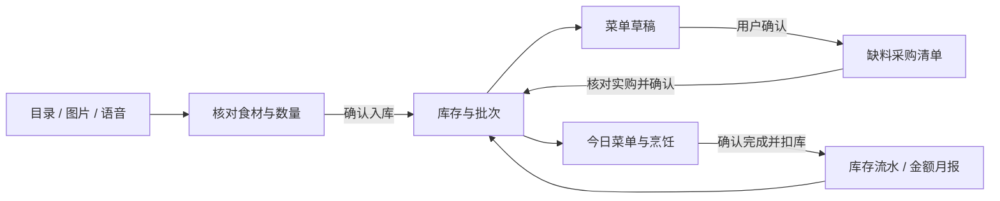
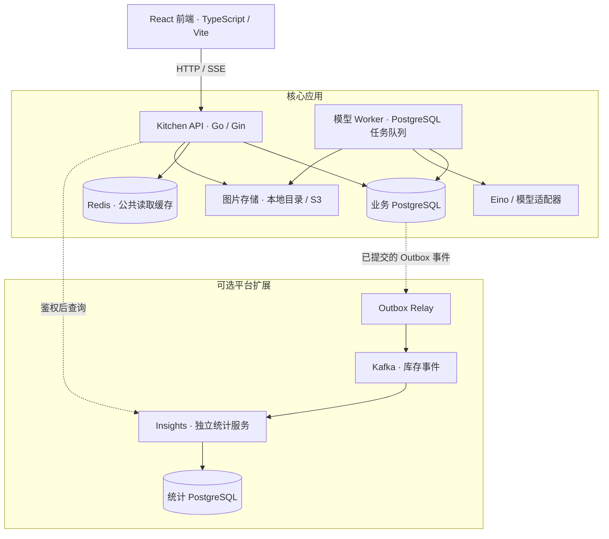

<p align="center">
  
</p>

<h1 align="center">FoodFlow 食光</h1>

<p align="center"><strong>从一人厨房开始，把食材、菜单和拿手菜连接起来。</strong></p>

<p align="center">
  <a href="#功能实景">界面展示</a> ·
  <a href="#可以做什么">功能</a> ·
  <a href="#架构与技术栈">技术栈</a> ·
  <a href="#快速开始">快速开始</a> ·
  <a href="#下载一次后续一键更新">一键更新</a> ·
  <a href="docs/README.md">项目文档</a>
</p>

<p align="center">
  <a href="https://github.com/link1ks/FoodFlow/actions/workflows/ci.yml"></a>
</p>

FoodFlow 是个人食材管理与 AI 膳食规划应用。登录后直接使用个人厨房，家庭共享按需开启；库存、菜单、采购和烹饪记录各有归属。AI 提出方案，用户确认后才执行库存变更。

## 功能实景

从「今天」开始，查看家中食材、临期提醒、待确认方案和采购待办。


以下为真实应用在隔离环境中的截图，使用虚构个人厨房与演示数据。菜单生成采用确定性演示模式，社区初审使用本地固定响应；本次展示未调用收费模型。点击图片可查看大图。

| 食材库存 · 家里有什么 | 食材目录 · 选图入库 |
| --- | --- |
| [](docs/assets/showcase/inventory-desktop.png) | [](docs/assets/showcase/catalog-desktop.png) |
| 查看余额与批次，勾选食材探索可做菜谱；临期提醒帮助安排处理顺序。 | 按名称、别名和分类寻找食材，核对数量后再确认入库。 |

| 菜单规划 · 先看方案 | 采购入库 · 再次核对 |
| --- | --- |
| [](docs/assets/showcase/ai-draft-desktop.png) | [](docs/assets/showcase/purchase-confirm-desktop.png) |
| 按人数、时间与忌口安排菜单，确认方案后生成缺料清单；做饭完成再扣库存。 | 菜单缺口进入采购清单；买好后核对实际数量、存放位置和有效期。 |

| 金额月报 · 保留未知 | 配方社区 · 分享拿手菜 |
| --- | --- |
| [](docs/assets/showcase/monthly-desktop.png) | [](docs/assets/showcase/community-desktop.png) |
| 汇总已记录采购金额与已知出库成本，缺失成本保留未知，支持导出 PNG。 | 分享用量与步骤，初审通过后公开；支持点赞收藏与每周候选。 |

<details>
<summary><strong>查看手机界面</strong> · 今日待办与库存卡片</summary>

<p align="center">
  <a href="docs/assets/showcase/today-mobile.png"></a>
  <a href="docs/assets/showcase/inventory-mobile.png"></a>
</p>

</details>

完整的操作串联、截图来源和重拍方法见 [功能图解](docs/SHOWCASE.md)。

## 可以做什么

| 功能 | 日常用途 |
| --- | --- |
| 🥦 食材管理 | 查看多批次库存与临期食材，使用目录或语音草稿确认入库，记录报损和数量校准 |
| 📅 菜单与烹饪 | 浏览配方、规划餐次、查看缺料与备餐时间轴，确认后扣减库存 |
| 🛒 采购清单 | 将菜单缺口转为待购清单，确认实购数量后入库 |
| 📊 厨房记录 | 查看库存流水、营养估算、采购与消耗金额月报，导出 PNG |
| 🤝 配方社区 | 发布带用量、步骤和封面的动态，点赞收藏，参与每周精选与积分装饰 |
| 🏡 可选家庭 | 在个人中心创建或加入家庭，邀请成员协作并切换厨房 |



社区动态的配方与封面经过 Agent 初审后才公开。每周点赞前三道作为候选，每位作者最多一席，管理员确认后署名收录食谱库；积分用于徽章、头像框和主题。审核未配置或异常时，动态保持私有。设置与规则见 [社区指南](docs/COMMUNITY.md)。

## 快速开始

运行需要 **Git、Docker 和 Docker Compose**。以下命令以 Windows PowerShell 为例；其他系统可以使用对应的文件复制命令。

```powershell
git clone https://github.com/link1ks/FoodFlow.git E:\FoodFlow
cd E:\FoodFlow
Copy-Item .env.example .env
```

打开 `.env`，将 `JWT_SECRET` 设置为至少 32 字节的随机密钥；数据库密码也可在首次启动前设置。随后启动（已包含必需的 Redis，无需额外启用平台扩展）：

```powershell
docker compose up --build -d --wait --wait-timeout 180
docker compose ps
```

| 入口 | 地址 |
| --- | --- |
| 应用 | <http://localhost:5173> |
| API | <http://localhost:8080/api> |
| 就绪检查 | <http://localhost:8080/health/ready> |

注册后即可进入个人厨房。菜单模型未配置时使用演示模式；真实菜单模型、图片识别、社区审核和短信需单独配置。模型 API 费用由服务商计费，完整设置见 [.env.example](.env.example) 与 [账号和 AI 额度](docs/ACCOUNT_RECOVERY_AI.md)。

需要独立、禁用收费集成的本机部署，可使用 [独立部署指南](docs/LEARNING_DEPLOYMENT.md)，地址为 `127.0.0.1:17173`，数据与默认部署分开保存。

语音添加食材使用独立配置的百炼 Qwen ASR。录音识别后可修改食材与数量，核对确认才入库；模型未配置时继续使用目录。浏览器录音需要 HTTPS 或本机 localhost，也可上传音频文件。配置和边界见 [语音入库](docs/VOICE_INTAKE.md)。

## 下载一次，后续一键更新

首次通过 `git clone` 下载后，Windows 用户可以：

| 操作 | 方式 |
| --- | --- |
| 检查更新 | 双击 `check-update.cmd` |
| 更新源码 | 双击 `update.cmd` |
| 更新并重建默认 Docker 部署 | 先备份数据库与照片，再运行下面的命令 |

```powershell
powershell -NoProfile -ExecutionPolicy Bypass -File scripts/update.ps1 -Restart
```

脚本遇到本地修改、分支分叉或未完成的 Git 操作会停止，保留配置和数据。其他系统可使用 `git pull --ff-only`，再按原部署方式重建。

更新同步的是**代码**；不同电脑独立部署的账号、库存和照片不会自动同步。共享数据需访问同一个部署，迁移数据需配套备份数据库与照片。详细说明见 [一键更新](docs/UPDATING.md) 和 [备份恢复](docs/BACKUP_RECOVERY.md)。

## 架构与技术栈

前端采用 **React、TypeScript、Vite**，后端为 **Go API 与独立 Worker**，核心业务使用 **PostgreSQL**。**Redis 是必需依赖**，缓存公共食材目录、菜谱和官方价格查询；Kafka 与独立 Insights 服务用于可选的异步统计。

| 层次 | 技术 |
| --- | --- |
| 页面与状态 | React、TypeScript、Vite、Tailwind CSS、Radix、TanStack Query、Zustand |
| API 与后台任务 | Go、Gin、OpenAPI、SSE、PostgreSQL 任务队列 |
| 数据、缓存与迁移 | PostgreSQL、Redis、pgx、sqlc、goose |
| Agent 与模型 | Eino、兼容 Chat Completions 的模型适配器、结构化输出校验 |
| 图片与部署 | 本地目录 / S3、Docker Compose、GitHub Actions |
| 可选平台扩展 | Kafka / franz-go、独立 Insights 服务 |
| 测试与工程反馈 | Go testing、Testcontainers、Vitest、Playwright、工程 Harness |



库存、不可变流水与 Outbox 在同一事务提交；服务端校验厨房权限，幂等键防止重复写入。Redis 不保存权威库存或权限。设计细节见 [业务架构](ARCHITECTURE.md) 与 [服务边界](docs/PLATFORM.md)。

所有部署均自动启动 Redis，且不向主机发布 Redis 端口。直接运行 API 时必须设置可访问的 `REDIS_URL`；未配置或连接失败会拒绝启动。Redis 故障会使就绪检查返回 503，运行中的公共读取仍可短时回源数据库；缓存最多保留 60 秒，公共菜谱入库和官方价格更新可能在此期间显示旧值。

### 开发与验证

开发与验收需要 Go 1.26、Node.js 24、pnpm 11、PowerShell 7 和 Docker：

```powershell
pnpm --dir web install --frozen-lockfile
pnpm --dir web exec playwright install chromium
go run ./cmd/harness -mode full
go run ./cmd/harness -mode acceptance
```

`full` 检查源码约束、数据库集成、生成契约、前端测试与构建；`acceptance` 在独立环境验证浏览器、厨房流程和平台恢复。模型测试使用确定性 fixture。最新提交的云端结果见 [GitHub Actions](https://github.com/link1ks/FoodFlow/actions/workflows/ci.yml)，验证范围见 [验证说明](docs/VERIFICATION.md)。

| 目录 | 内容 |
| --- | --- |
| `cmd` / `internal` | 服务入口、业务、算法与模型适配器 |
| `web` | 应用页面、共享状态与公共资产 |
| `sql` / `openapi.yaml` | 数据库迁移、查询与 API 契约 |
| `scripts` / `tests` | 更新、部署、备份和验收工具 |
| `docs` | 项目设计、使用、维护和质量说明 |

更多入口：[文档导航](docs/README.md) · [开发与贡献](CONTRIBUTING.md) · [安全说明](SECURITY.md)。

## 当前范围

- 营养是原料组成估算，缺失数据保留未知；参考菜谱的份量与耗时为估计。
- 真实模型准确度、短信送达、S3、公网 HTTPS 与生产高可用仍需验收；应用额度控制不等于服务商账单封顶。
- 社区初审不替代人工入库审核；举报治理、多账号刷票防护与真实用户体验仍待完善。

完整未完成项见 [质量台账](docs/QUALITY.md)。当前前端与 API 版本为 **v0.2.0**，后续变更见 [更新日志](CHANGELOG.md)。

## 许可

项目尚未指定开源许可证，使用与分发授权由项目所有者明确。参考照片保留各自授权，见 [照片来源与署名](web/public/ingredient-photos/credits.html)。
