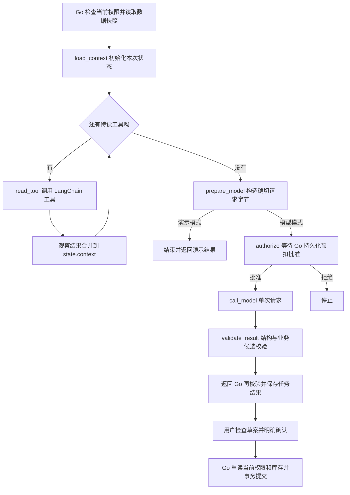
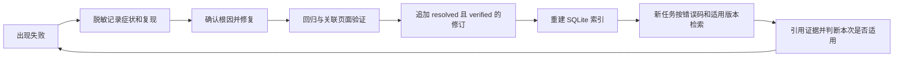

# FoodFlow Agent：LangChain、LangGraph 与闭环

本次迁移把项目现有 Python Agent 的执行编排改为 LangGraph，使用 LangChain 的
`@tool` 定义有输入约束的读取工具。入口仍是 Go Worker，业务界面和 API 不变。
这是一条**有界工作流**：程序决定读哪些工具，每个任务最多一次模型请求。
没有启用模型自主选择任意工具的 ReAct 循环，也没有新增用户聊天或自动记忆功能。

## 先跑一个不收费的例子

在项目根目录的 PowerShell 执行：

```powershell
powershell -NoProfile -ExecutionPolicy Bypass -File scripts/prepare-python-agent.ps1
.cache/python-agent-venv/Scripts/python.exe -I -B internal/agent/python/learn.py
.cache/python-agent-venv/Scripts/python.exe -I -B internal/agent/python/test_graph.py
go test ./internal/agent -run 'TestLangGraphAgentContracts|TestPythonAgentGuardMatchesExactUTF8RequestAndRejectsUnsafeRecipe' -count=1
```

第一条安装锁定依赖，可能下载文件。学习例子只使用虚构厨房和固定模型函数，
不读取 `.env`、不连接数据库、不调用真实模型。它运行生产使用的同一张图，
按顺序输出节点、上下文字段和结果；`model_calls` 应为 1。
`learn.py` 的 `InMemoryStore` 仅演示记忆读写，退出程序后消失。

阅读顺序：

1. [learn.py](../internal/agent/python/learn.py)：一次完整的虚构任务。
2. [runtime.py](../internal/agent/python/runtime.py)：`AgentState`、`context_tools`、`build_agent`、`dispatch`。
3. [python_bridge.go](../internal/agent/python_bridge.go)：Go 如何启动 Python、批准请求和处理取消。
4. [jobs.go](../internal/app/jobs.go)：`chooseRecipe` 如何鉴权、读数据、调用模型并检查候选 ID。
5. [ai_allowance.go](../internal/app/ai_allowance.go)：真实请求前的持久化占额。

## 闭环是怎么建立的



`State` 是节点间传递的工作数据；节点负责处理，边决定下一步。
真正回到前一步的循环是 `read_tool → 检查 pending → read_tool`。
每次从 `pending` 移除一个工具，并增加 `tool_steps`，最多 3 次；图另设
`recursion_limit=12` 防止意外无限执行。工具观察结果进入下一步的上下文，
模型得到完整快照后产生建议，校验器决定是否接受。

模型输出无效时本次任务失败，不自动再问模型“修好它”。因为一次重试可能
再次收费，而且网络超时不代表供应商没收到请求。需要重做时走现有显式任务流程。
HTTP 只发一次，不跟随重定向；连接取消由 Go 杀掉子进程。
结果不明的请求保留占额，不能伪装成免费失败。

框架执行闭环和业务闭环是两层：生成建议不等于已经完成采购或扣库存。
菜单、图像和语音草案仍需用户确认；Go 才能在事务中更新库存、不可变流水与 Outbox。
社区初审遵循原来的版本审核/发布事务，不因此获得库存工具。

## 工具怎么处理

LangChain 的 `@tool` 把普通 Python 函数变成带名称、说明和参数 schema 的工具。
项目的工具只接受 `scope="current_request"`，多余参数一律拒绝。
它们通过闭包取得当前任务的数据副本，不接受模型指定的家庭 ID、SQL、URL 或文件路径。

| 工具 | 数据来源 | 用途 |
| --- | --- | --- |
| `read_preferences` | Go 授权后读取的偏好与当前请求字段 | 用户目标、份数、忌口等 |
| `read_inventory` | Go 按厨房范围查询的库存快照 | 有据可依的现有食材 |
| `read_recipes` | Go 已筛选的候选菜谱 | 限制模型只能选允许的 ID |
| `read_submission` | 用户明确提交的社区配方 | 初审限定内容 |
| `read_verified_memory` | 工程 RAG 传入的历史证据 | 仅允许已验证、无冲突且版本/错误码匹配的经验 |
| `read_evaluation_fixture` | 显式工程评测输入 | 保留原始负例，不冒充生产过滤效果 |

图像与语音任务直接读取已提交的媒体，不需要库存读取工具。所有真实模型任务
仍经过 `prepare_model → authorize → call_model → validate_result`。

`read_tool` 调用 `.invoke(...)` 后把返回字典合并到 `state.context`。
工具异常会终止图，不转成“读到了空库存”。快照和返回值都复制，防止一次调用
修改后污染另一次调用。测试中发现无参数工具在当前框架版本会跳过空 schema
的参数校验，因此使用必填且固定的 `scope` 字段，并保留越权参数回归。

当前工具由程序按任务类型调度，不使用 `bind_tools` 或 `ToolNode` 来执行模型
返回的 `tool_calls`。模型若擅自返回工具调用，直接拒绝。以后若要升级自主工具
循环，需要另外设计逐次调用授权、总步数/费用上限、工具观察消息和恢复幂等。

## 上下文怎么读取

以菜单推荐为例，`chooseRecipe` 先检查发起人的当前厨房权限，然后读取：

- 用户本次输入：偏好、餐次、份数。
- PostgreSQL 中明确保存的家庭偏好。
- 当前家庭最多 100 项库存汇总。
- 经时间、忌口筛选后最多 20 个候选菜谱。

Go 把这些信息序列化，通过私有 stdin 管道传给 Python。Python 不读取数据库、
浏览器历史、其他聊天或工作区文件；工具只看到本次允许字段。
`prepare` 将规则放在 system 消息，将快照放在 user 消息，并明确其中内容是数据。
`validate` 在模型调用后检查结构和候选 ID，Go 还会再校验。
提示词本身不能替代服务端鉴权或确定性校验。

请求密钥留在 Python 调用闭包内，不进入图状态或工具 schema。
Go 传给子进程的环境为白名单；`-I` 隔离用户 Python 路径。
生产执行关闭 LangSmith tracing，不配置 checkpointer，避免把密钥、媒体和私有
上下文存成额外轨迹。`learn.py` 展示的节点记录全部来自虚构输入。

## 记忆怎么产生

先区分四种经常被一起称为“记忆”的东西：

| 类型 | 本项目在哪里 | 如何产生、何时消失 |
| --- | --- | --- |
| 本次工作状态 | LangGraph `AgentState` | 工具观察逐步填入；子进程退出后消失 |
| 用户明确保存的偏好 | Go 管理的 PostgreSQL households | 用户保存设置后产生；下次鉴权读取，修改后以当前值为准 |
| 任务历史 | jobs、job_events 和结果 | Go 记录执行事实；不是自动拼进下次提示词的聊天历史 |
| 工程经验记忆 | 私有经验记录与派生 SQLite RAG 索引 | 记录失败、复核根因、修复并回归后成为可推荐的经验 |

LangGraph **不会自动生成可信的长期记忆**。业务偏好依赖明确保存，工程经验依赖
证据与复核；模型说“用户不吃花生”不等于用户已确认这一事实。
学习例子用 `InMemoryStore.put` 模拟明确保存，用 `get` 取回并加入上下文；按厨房
命名空间隔离，并演示模型输出不会自动写入 Store。命名空间只是组织键，实际
权限必须在 Go 服务端检查。生产偏好仍使用已有数据库，不使用这个内存 Store。

工程经验的实际闭环是：



原始经验记录是权威历史，SQLite 是可以重建的检索索引。未验证、有冲突或版本
不匹配的记录不能进入生产建议；生成的引用和修复文本还要严格核对。
工程经验属于开发工具，不会自动混入用户菜谱建议。

如果以后要做多轮聊天，可为线程接入 checkpointer，为跨会话信息接入 Store。
这次没有启用：当前任务是有租约和付费约束的一次性作业，直接恢复模型节点
可能重复发送。持久化聊天需要独立设计保留期限、删除、权限、脱敏与发送幂等。

## 动手观察三个变化

1. 修改学习例子中显式保存的偏好，再运行：`read_preferences` 会把新值带入上下文。
   模型仍为固定 fixture，所以不能据此判断真实模型遵从偏好的质量。
2. 将 `fake_model` 返回的 ID 改为 `invented`：运行在 `validate_result` 失败，
   不会重试，不会生成可确认的结果。完成实验后撤销改动。
3. 在 `test_graph.py` 中看工具越权、不同请求隔离和未验证记忆案例：
   这些测试检查边界行为，比只看一次正常输出更能解释闭环的可靠性。

官方参考：[LangGraph 图与状态](https://docs.langchain.com/oss/python/langgraph/graph-api)、
[LangChain 工具](https://docs.langchain.com/oss/python/langchain/tools)、
[LangGraph 记忆](https://docs.langchain.com/oss/python/langgraph/add-memory)。
本项目锁定依赖见 [requirements-agent.txt](../requirements-agent.txt)，升级后应重新运行回归。
