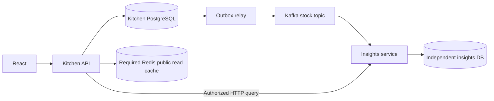

# Service ownership and event delivery



The API owns users, permissions, inventory, procurement, menus and authoritative writes. Model Worker keeps its existing PostgreSQL queue and lease fencing. Insights is a separate executable and database owner; its only kitchen input is the versioned stock event. API checks current household membership before forwarding a request authenticated with an internal service token. Statistics cannot mutate inventory.

The Go Worker invokes an embedded Python 3.13 agent in a bounded child process.
Python owns prompts, provider HTTP requests and structured model outputs for
planning, nutrition advice, vision, speech and community review; demo selection
also executes Python. Go retains database authorization, deterministic quantities,
lease fencing and final business validation. Python receives no database credentials.
Its private JSON pipe reports the exact UTF-8 provider request size before the
Worker's durable allowance guard authorizes dispatch. Cancellation kills the child;
missing/uncertain results retain the debit. There are no provider retries or
redirects. `FOODFLOW_PYTHON` can select a native interpreter; Docker and CI pin
Python 3.13. The source is embedded in Go so deployed agent code matches the binary.

Engineering RAG executes embedded Python: exact lexical/concept cosine, SQLite
inverted postings, lifecycle filtering and grounded citation validation. Go
retains immutable evidence storage and completion gates. Derived indexes bind
history digest/version; rebuild them after upgrading. Full queries include an
audit scan. [Engine and bridge measurement scope](exec-plans/python-rag-scale.md).

Kitchen API also owns recovery-code hashes tied to credential epochs and durable AI policy allowances. Worker commits a unique job debit under the service-wide PostgreSQL lock before each outbound paid request. Model adapters receive a guard callback, never a database client. Unknown outcomes retain debit/concurrency until explicit operator review; this ledger is an application policy, not provider invoicing. [Account and allowance guide](ACCOUNT_RECOVERY_AI.md) records the learning boundary.

Kitchen API owns [voice ingredient intake](VOICE_INTAKE.md): consented recordings use the shared private object store and a single-attempt Worker job. The independently configured Qwen ASR adapter transcribes under the same durable paid-call guard; pure `internal/engine/intake.Interpret` enforces a bounded addition grammar, resolves explicit correction/retraction targets, and prepares catalogue drafts without I/O. Out-of-scope results cannot be confirmed. Recognition changes no stock. Explicit confirmation commits all batches, immutable ledger facts and outbox events in one kitchen transaction. Image intake also requires a photo observation with exactly one visible ingredient and a unique current catalogue match, rechecked during confirmation. [Scope evaluation](INTAKE_SCOPE.md) records false accepts, conservative rejection and model-call latency. Representative recognition quality and interrupted-job audio cleanup remain documented limits.

Redis is a required API dependency in development, acceptance, learning and restore deployments. The API rejects missing/invalid `REDIS_URL` and failed startup PING without exposing credentials. `/health/ready` checks both PostgreSQL and Redis; Redis outage returns 503 while `/health/live` remains available. Worker uses PostgreSQL jobs and does not need a Redis connection.

Redis caches the public catalog, recipe list and official benchmark/dashboard reads for at most 60 seconds after authentication and, for household routes, current membership checks. Keys contain no household data; public query keys hash structured filters and price keys also include the Shanghai calendar day. Only complete successful results are cached. Reads/writes use short deadlines, no retry storm, and database fallback during runtime outages. Inventory balance, permissions, session revocation, idempotency and paid-call/lease fencing remain authoritative in PostgreSQL. Cache metrics are on API `/metrics`; catalog responses expose `X-Catalog-Cache`, other public cached reads expose `X-Public-Cache`. Public data updates, including accepted community recipes and official price imports, can be stale for one TTL. Redis contents are disposable and are rebuilt from PostgreSQL after restart; business recovery does not restore a Redis snapshot.

Migration 028 creates outbox events in the same transaction as the immutable ledger, after its historical snapshot trigger. Existing snapshot-backed rows are initialized with their original facts; older rows without snapshots are not invented. Relay holds an outbox row lock through bounded broker acknowledgement, then marks it published. A crash between broker acknowledgement and DB commit may republish the same ID. Broker outage queues events while core writes continue.

Kafka topic `foodflow.stock.v1` partitions by household ID. Consumers validate schema and signs; they insert a fact with a unique event ID in their local transaction and commit Kafka offsets afterward. Duplicates do not count twice; conflicting IDs or malformed payloads are quarantined with a digest and Kafka coordinates. Logs avoid message bodies and credentials. Quarantine investigation and replay require an operator; automatic mutation of rejected payloads is not provided.

Monthly quantities group by ingredient and exact unit; grams, milliliters and counts are never summed into an invented total. Query windows use the household timezone. Projection is eventually consistent and displays last receipt time; this timestamp alone is not an exact measure of consumer lag. The independent projection reports quantities only. The kitchen API separately owns `/monthly-report`, an authoritative read of immutable purchase and outbound cost snapshots: CNY known-cost subtotals, missing-cost event counts and original-unit quantities. Recorded purchase amounts use their cost-recording date, not a claim about when cash was paid. Missing costs and old snapshots are never replaced with current prices; reports do not establish savings. PNG exports include the coverage and show at most 40 detail groups per page; API detail is capped at 200 groups while totals cover every monthly fact.

## Local deployment

Kitchen API also owns [personal kitchens](PERSONAL_KITCHENS.md): the existing transactional household scope has a private/shared discriminator and a per-user default mapping. Explicit idempotent provisioning locks the account. Private access requires ownership as well as membership, and private kitchens cannot accept invitations. Optional families retain their data and roles; verified account merges preserve private histories under the retained owner. No inventory/cache/insights ownership boundaries change.

Kitchen API also owns the global authenticated [recipe community](COMMUNITY.md): posts, catalogue-bound quantities, reactions, reviewed library admissions and an append-only cosmetic-points ledger. A separate transaction lock protects replay and balance consistency without taking kitchen inventory locks. Worker freezes the previous Shanghai calendar week's shortlist hourly; review requires an explicit `COMMUNITY_ADMIN_IDS` allowlist, independent of household roles. Community does not emit inventory events or query the insights database. Cover bytes are stored in kitchen PostgreSQL and included in its database backup.

Community preliminary moderation runs in the same Worker using a PostgreSQL revision queue and fenced leases. A multimodal adapter receives only the consented recipe and normalized cover, with no database or publication tools. Its unique revision dispatch ledger shares the kitchen AI service allowance lock and aggregate limits. Failed, ambiguous or invalid outcomes stay non-public; ambiguity never triggers an automatic paid resend. Publication and its once-only points award commit together. Weekly library admission remains an explicit administrator decision. Acceptance uses a local deterministic HTTP fixture; it does not establish real model judgement quality.

```powershell
pwsh -File scripts/local-acceptance.ps1 up
pwsh -File scripts/platform-acceptance.ps1
```

The first script starts the isolated base stack including required Redis. The second enables optional Kafka/Relay/Insights through `deploy/compose.platform.yaml`. Redis and Kafka bind no host ports; service traffic stays on its network. Insights has a separate PostgreSQL database/container and secret; volumes persist independently. The main development Compose also includes Redis and remains usable without Kafka/Insights. The application is available at `http://127.0.0.1:15173`. Container API uses `redis://redis:6379/0`; native API development requires a separately reachable Redis endpoint in `REDIS_URL` because Compose does not publish port 6379.

Local single-node Kafka uses KRaft without ZooKeeper, one replica and plaintext internal traffic. Production requires replication, SASL/TLS, Redis ACL/TLS, managed secrets, network isolation, alerts for outbox age/consumer lag/quarantine, retention and backup policies. Keeping the two databases on distinct containers demonstrates ownership; it is not a claim of production high availability.

## Diagnosis and recovery

For the isolated learning kitchen, use [the paired database/photo recovery workflow](BACKUP_RECOVERY.md). `cmd/recovery` and `internal/recovery` are offline maintenance tools owned by kitchen operations; they read all kitchen tables/sequences and image files, never serve user requests or import projection data. Restore drills run only in new private projects. This does not cover the independent insights database or Kafka replay.

Use the same `--env-file .cache/acceptance.env -f deploy/compose.acceptance.yaml -f deploy/compose.platform.yaml` arguments for Compose diagnostics. `exec db psql -U foodflow -d foodflow` can inspect `stock_outbox` pending count, oldest `created_at`, retry time and attempts; inspect `rejected_events` in `insights-db` for poison message coordinates. `exec kafka /opt/kafka/bin/kafka-consumer-groups.sh --bootstrap-server kafka:9092 --describe --group foodflow-insights-v1` shows committed offsets and lag.

Back up the kitchen database and image objects as before; additionally back up the insights database with `pg_dump -U insights -d insights -Fc` into a protected local file. Recovery must target a fresh database before comparing counts and projections. Kafka volume is not a substitute for PostgreSQL backups. If the projection needs a full rebuild beyond Kafka retention, retained snapshot-backed outbox payloads are the replay source: pause relay, prepare a fresh projection, explicitly reset selected outbox publication markers, then resume relay and verify convergence. This administrative operation is deliberately not exposed as a user API. Replaying into an existing projection is safe against identical IDs, but a missing historical snapshot cannot be reconstructed from today's ingredient values.

Kitchen operations owns the [local learning release workflow](LEARNING_RELEASE.md). Learning images bind the current harness source digest; release artifacts contain committed source, public checksums and exact retained image identities, never credentials or business data. Switching only recreates kitchen API/Worker and the web gateway after a paired backup, refuses schema/history/database/topology drift, and does not downgrade or replace the database. Same-schema binary compatibility still requires version-specific review.
