# FoodFlow 功能图解

这些截图来自真实应用的独立 acceptance 环境（本机 15173），拍摄于 2026-10-16。账号、食材余额、采购金额、配方及社区候选均为虚构数据；未使用默认开发厨房或个人浏览器会话。截图展示当前界面与操作边界，不代表真实识别准确率或生产运行效果。

## 1. 打开厨房，先看今天

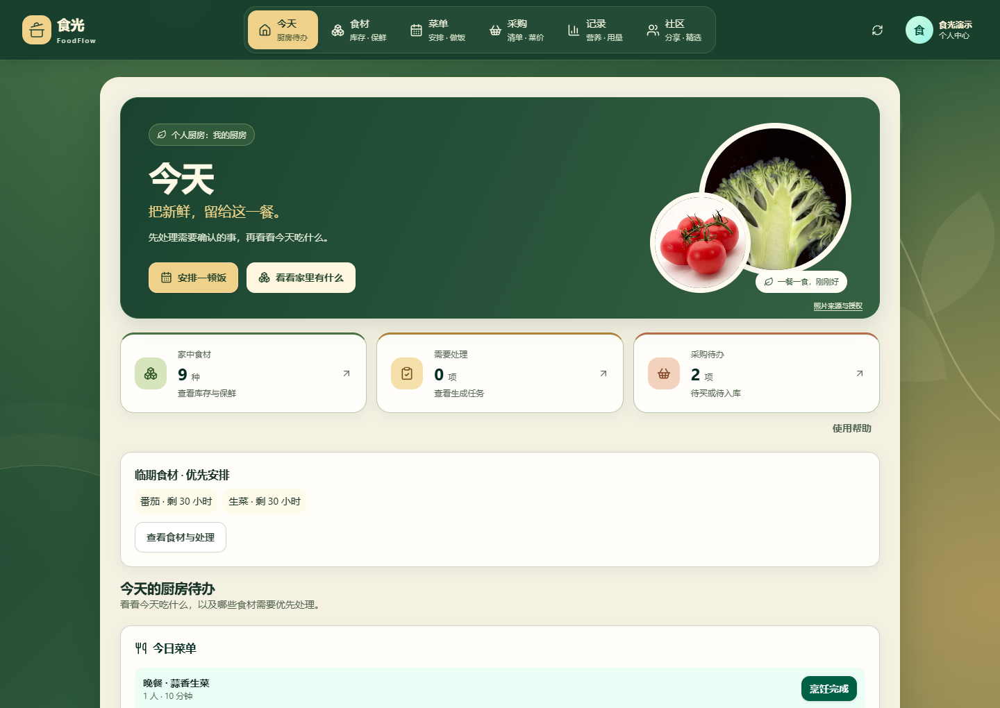

个人厨房是登录后的默认入口。「今天」汇集库存种类、临期批次、待确认任务、待购项和今日菜单。示例有 9 种食材，番茄与生菜即将到期；这些时间提醒不判断食物是否安全可食。

## 2. 选食材，核对后入库

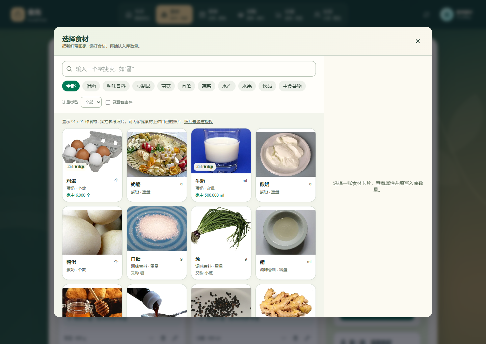

目录提供 91 种食材参考照片、搜索、分类和单位维度筛选。选择食材后录入数量，确认才创建库存批次。参考照片不表示用户实际拍摄，照片来源及许可见 [署名页](../web/public/ingredient-photos/credits.html)。

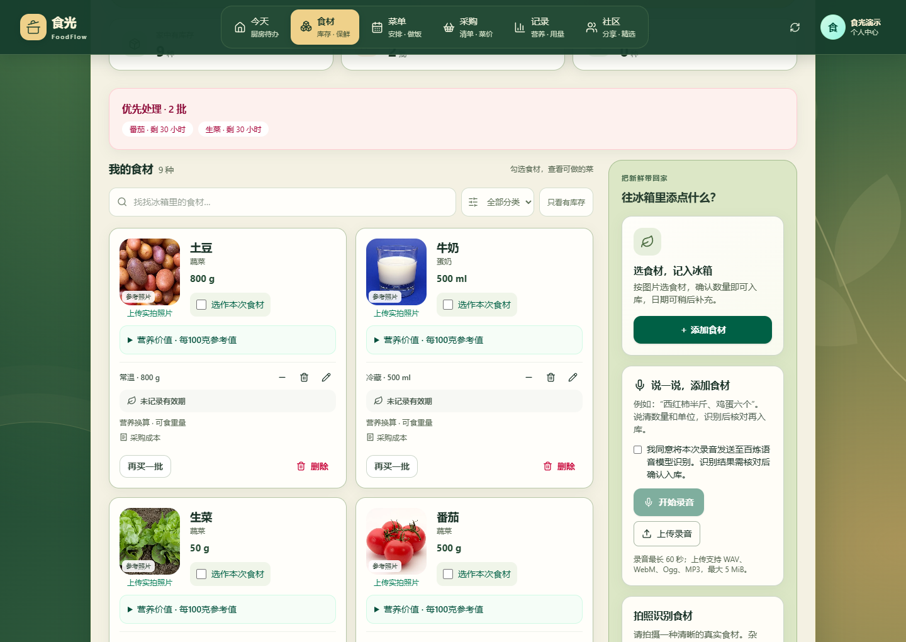

库存保留精确数量、单位、存放位置与批次；不同计量单位分别显示。勾选食材可以查看可做菜谱和缺口。图片、语音识别同样先生成可修改草稿，确认后才入库；本组截图未验证真实录音或视觉识别效果，使用边界见 [语音入库](VOICE_INTAKE.md) 与 [识别范围](INTAKE_SCOPE.md)。

## 3. 安排菜单，确认缺料

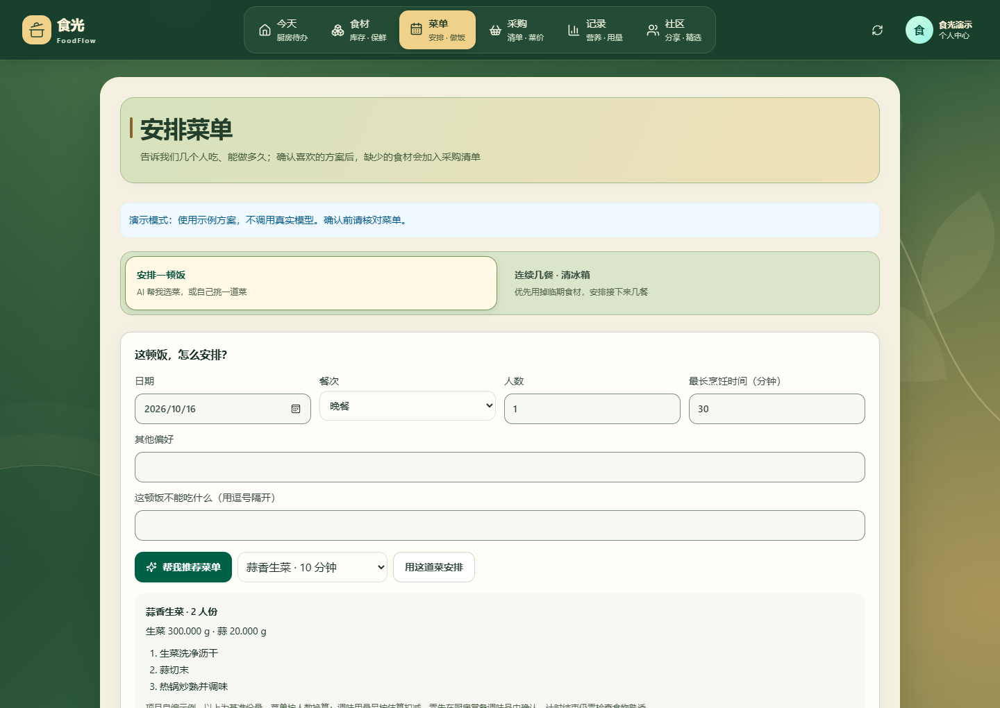

可以手工选菜，也可以按人数、最长烹饪时间和忌口生成方案。示例为 1 人份蒜香生菜；基准配方是 2 人份，需要 300 g 生菜和 20 g 蒜，服务端按人数换算。

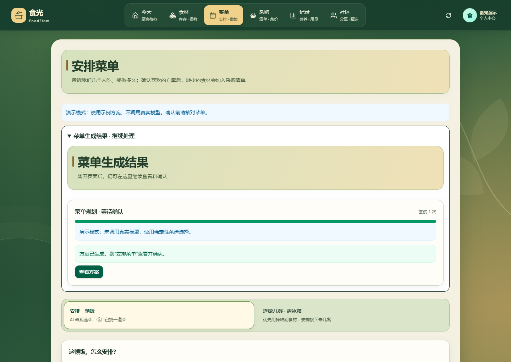

截图中的推荐使用**确定性演示模式**，未调用真实菜单模型。任务处于「等待确认」，生成草稿不扣库存；用户确认方案后才生成采购缺口，烹饪完成还需另一次确认。截图中的已确认晚餐与待确认推荐是两个独立方案。

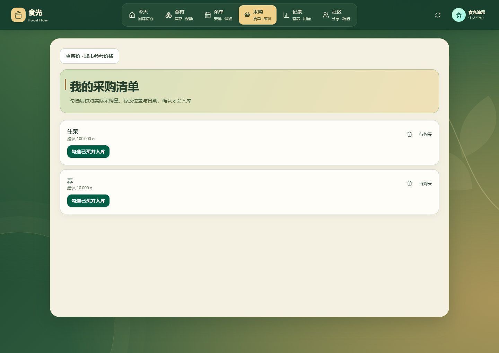

当前生菜余额是 50 g，1 人份需要 150 g，因此建议补买 100 g；蒜没有库存，建议补买 10 g。数量来自实际 API 的配方与库存计算。

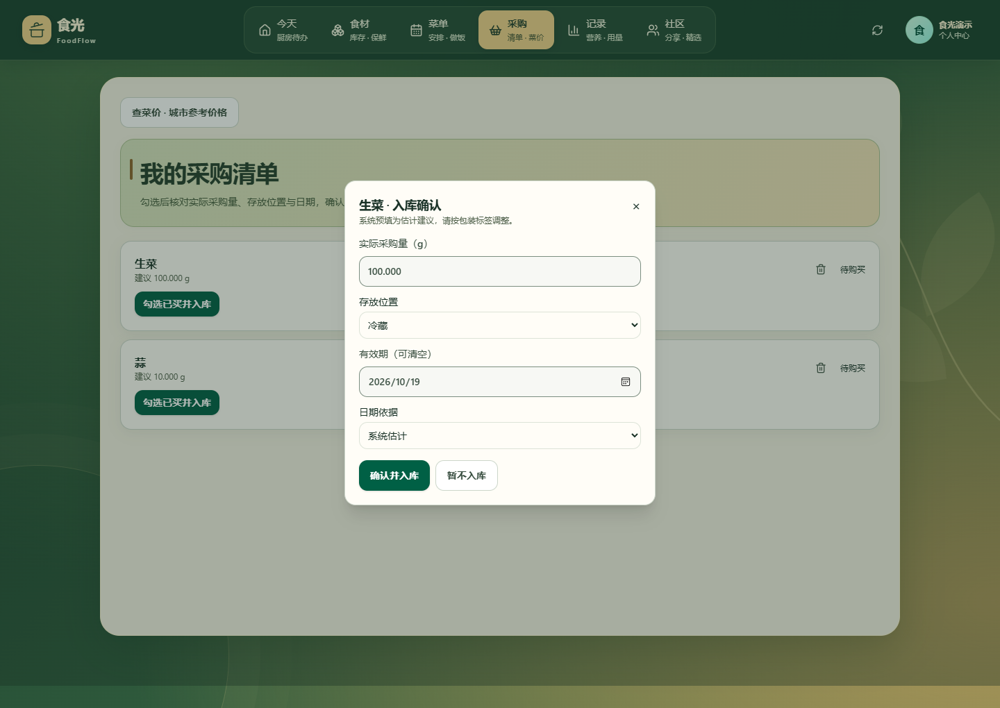

「勾选已买并入库」打开确认窗口，核对实购数量、存放位置、有效期及日期依据。预填有效期只是估计建议，需要按实际包装调整。本次截图选择暂不入库，保留两项待购状态。

## 4. 查看月报，区分已知与未知

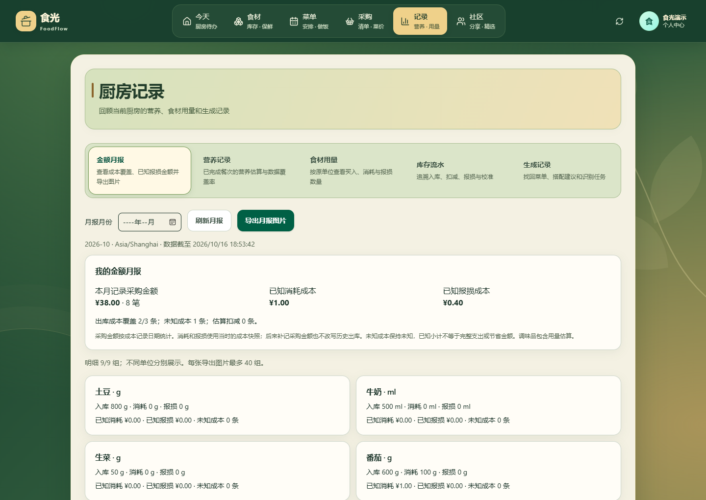

虚构示例记录 8 笔采购金额共 ¥38.00，已知消耗成本 ¥1.00、报损成本 ¥0.40。另有一笔未记录成本的黄瓜出库，显示出库成本覆盖 2/3 条、未知成本 1 条。历史缺失成本不会用现价补齐；这些小计不等于完整支出或节省金额。可导出 PNG，详细口径见 [服务边界](PLATFORM.md)。

## 5. 把拿手菜分享给社区

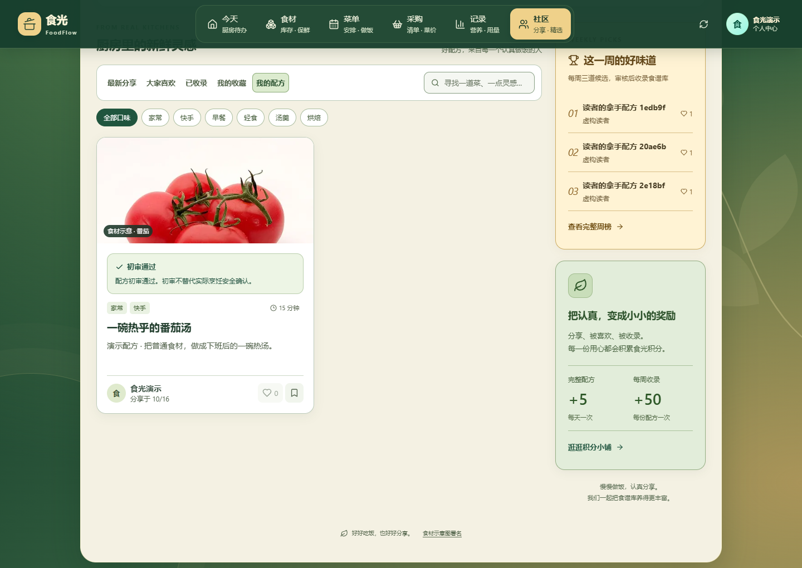

示例配方有明确用量、步骤和作者。此次社区初审由本地确定性 fixture 返回通过，不是实际模型审核质量的证据。公开配方支持点赞、收藏与每周候选；候选还需管理员确认才收录到菜谱库，详见 [社区规则](COMMUNITY.md)。

## 6. 在手机上查看待办与库存

<p align="center">
  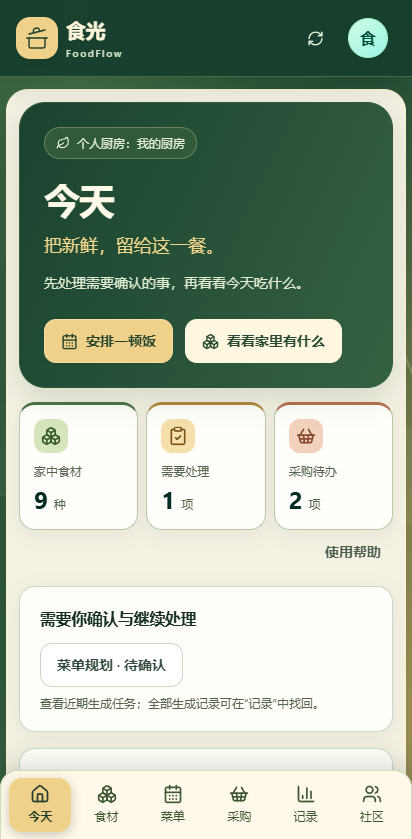
  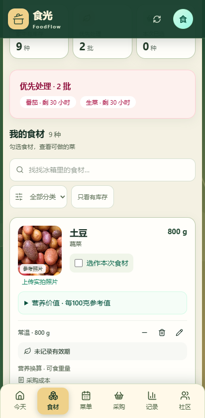
</p>

手机截图使用 Pixel 7 的浏览器视口与触摸模拟，保留底部导航；它验证浏览器布局，不代表真机安装或原生应用验收。

## 截图维护

使用已安装的前端依赖、Docker 和 Playwright 浏览器。只对固定 acceptance Compose 项目创建新的虚构账号与数据，不清空数据库或卷，不读取 `.env`。先按 [Harness](HARNESS.md) 准备隔离环境：

```powershell
pwsh -NoProfile -File scripts/local-acceptance.ps1 up
pwsh -NoProfile -File scripts/prepare-browser-fixture.ps1
$env:PLAYWRIGHT_CHANNEL = 'msedge' # 本机使用已安装的 Edge；CI 默认 Chromium
pnpm --dir web exec node ../scripts/capture-showcase.mjs
```

脚本核验 Compose 归属、菜单演示模式和社区本地模型地址，输出 11 张截图及 SHA256 清单至被忽略的 `.cache/harness/showcase`。页面发生脚本错误、API 5xx、横向溢出或关键内容未出现时失败。重拍前后应运行 `full`、相关 `acceptance` 与 `diagnose`，记录真实结果到执行计划。

人工检查截图中的文字、内容、隐私和图片加载后，只把审核过的 PNG 复制到 `docs/assets/showcase/`；不要发布会话、凭证、原始网络日志或整份 `.cache`。截图可能保留拍摄日期与当时的虚构候选榜单，更新界面后应一并重拍。
